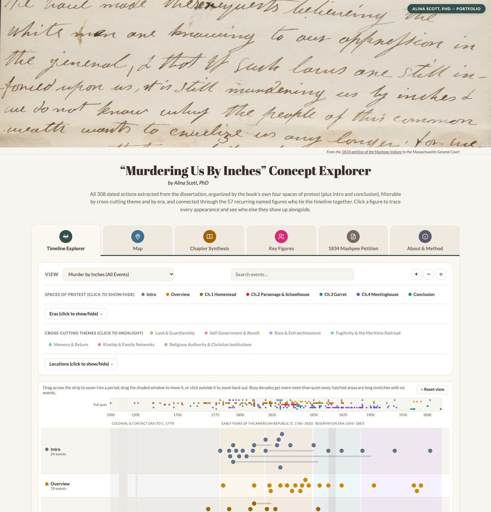

# “Murdering Us By Inches” Concept Explorer

**by Alina Scott, PhD** · **[Open the live site →](https://alinascott.github.io/ais.dissertationexplorer/)**

[](https://alinascott.github.io/ais.dissertationexplorer/)

An interactive companion to the dissertation *Murder by Inches: Family, Race, and Wampanoag Networks of Petitioners (1800–1870)* (PhD diss., University of Texas at Austin, 2025). It turns the dissertation’s dated actions, recurring people, places and arguments into views you can filter and follow, alongside one of its central sources: the 1834 petition of the Mashpee Indians, whose phrase “it is still murdering us by inches” gives the project its title.

## What’s on the site

Each section is a tab with its own link:

| Tab | What it shows |
|---|---|
| [Timeline Explorer](https://alinascott.github.io/ais.dissertationexplorer/#timeline-explorer) | 308 dated events in one row per part of the dissertation, filterable by chapter, era, theme, place and search. Click a dot for its details; drag the overview strip to zoom. |
| [Map](https://alinascott.github.io/ais.dissertationexplorer/#map) | The 25 places those events name, sized by number of events, with a list of places and the selected event alongside. |
| [Chapter Synthesis](https://alinascott.github.io/ais.dissertationexplorer/#chapter-synthesis) | Each section’s central argument, evidence, key people, places, themes and core claim. |
| [Key Figures](https://alinascott.github.io/ais.dissertationexplorer/#key-figures) | The 57 people who recur across the events; pick one to trace their thread through the timeline. |
| [1834 Mashpee Petition](https://alinascott.github.io/ais.dissertationexplorer/#mashpee-petition) | Manuscript pages beside their transcription, the full text, and all 286 transcribed signers, with links for those who also appear in the dissertation. |
| [About & Method](https://alinascott.github.io/ais.dissertationexplorer/#about) | How the data was gathered, what “possible match” means, how map locations are matched, and how to cite the site. |

The counts above describe the current data; the site itself computes every number it shows from the files in `data/`.

## How the data was made

In short (the full account is in the site’s **About & Method** tab):

- **Events** were extracted from the dissertation’s full text (front-matter timeline, chapters and conclusion), deduplicated, and assigned to the section they come from, with one primary theme and optional secondary themes.
- **Recurring figures** come from a curated list of names and variants, traced through every event.
- **Map locations** are matched automatically from place names in each event’s text, so some are approximate and 76 events name no mappable place.
- **Petition signers** were compared by hand with the dissertation. “In the dissertation” means the same name (or a documented spelling); “possible match” means likely but uncertain, and each carries a note.

## How to cite

> Scott, Alina. “Murdering Us By Inches” Concept Explorer. 2026. https://alinascott.github.io/ais.dissertationexplorer/.

The underlying research: Alina Scott, *Murder by Inches: Family, Race, and Wampanoag Networks of Petitioners (1800–1870)* (PhD diss., University of Texas at Austin, 2025).

## Repository contents

```
index.html                     the whole site: page, styles and code
data/
  events.json                  timeline events
  figures.json                 recurring figures and who appears with whom
  chapters.json, themes.json,  labels and colors for chapters, themes
  eras.json                    and eras
  locations.json               map locations
  main-event-locations.json    which places each event names
  chapter-synthesis.json       the Chapter Synthesis content
  petition-1834.json           petition text, signers and signer links
images/
  header.webp                  banner (1834 petition manuscript)
  petition-1834-page1.jpg      petition, page 1
  petition-1834-page11.jpg     petition, signature page
  social-card.jpg              preview image for shared links
  screenshot.jpg               the screenshot above
```

### Previewing changes locally

The page loads its data with `fetch()`, so open it through a local web server rather than by double-clicking `index.html`:

```bash
python3 -m http.server 8000
```

Then visit http://localhost:8000/. Changes pushed to `main` publish to the live site through GitHub Pages within a minute or two.

## Credits

Petition transcription and notes: [Native Northeast Portal](https://www.nativenortheastportal.com/annotated-transcription/digcoll1834012900). Map data © OpenStreetMap contributors, drawn with Leaflet. Charts drawn with D3. Research, data and site design by Alina Scott.
